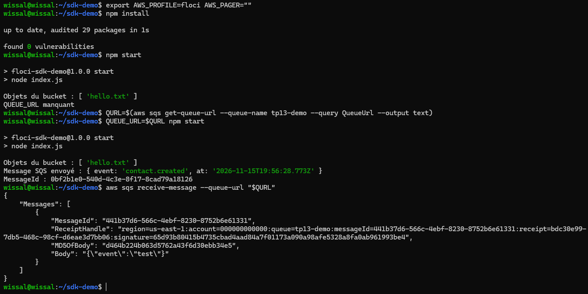
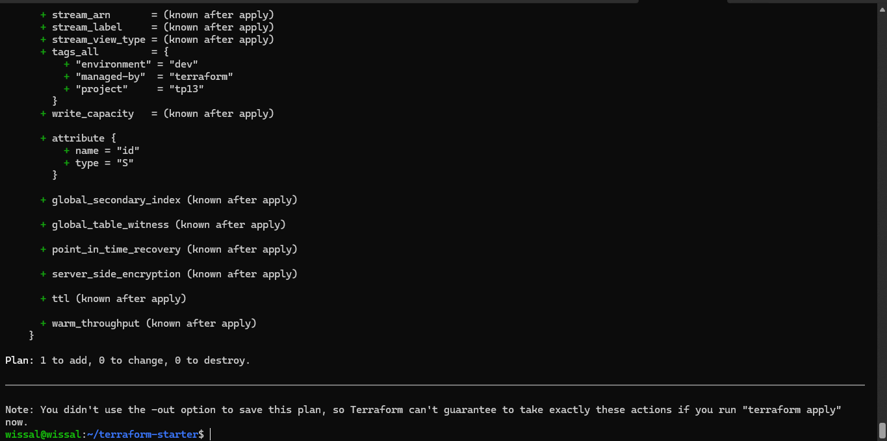
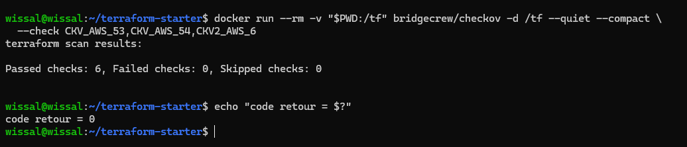
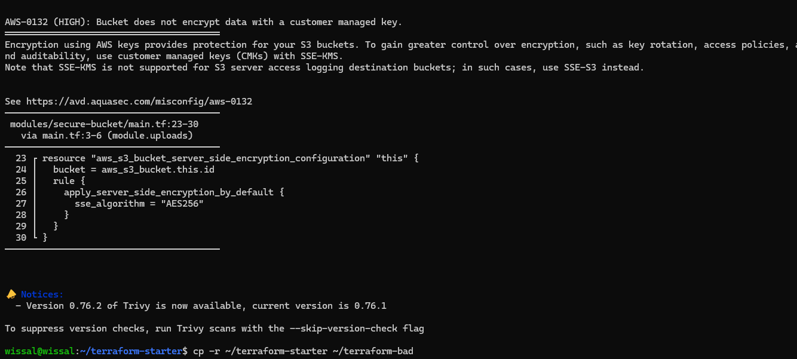
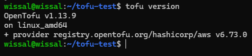

# TP13 : Cloud AWS local avec Floci et Terraform avancé

**Environnement :** VM Ubuntu Server, Docker, Terraform v1.17.2, OpenTofu v1.13.9, provider `hashicorp/aws` v6.73.0, Node.js 24, AWS CLI v2

Ce TP utilise **Floci**, un émulateur AWS local (licence MIT) exposé sur `http://localhost:4566`. Aucun compte AWS, aucune carte bancaire et aucune facture ne sont nécessaires : les identifiants sont fictifs (`test` / `test`, compte simulé `000000000000`).

---

## Sommaire

1. [Structure du rendu](#1-structure-du-rendu)
2. [Démarrage de Floci](#2-démarrage-de-floci)
3. [Partie 1 : AWS CLI](#3-partie-1--aws-cli-contre-floci)
4. [Partie 2 : SDK JavaScript](#4-partie-2--sdk-javascript)
5. [Partie 3 : Terraform et provider AWS](#5-partie-3--terraform-avec-le-provider-aws)
6. [Partie 4 : modules, environnements, state distant](#6-partie-4--modules-environnements-et-state-distant)
7. [Partie 5 : scan IaC et OpenTofu](#7-partie-5--scan-iac-et-opentofu)
8. [Comparaisons](#8-comparaisons)
9. [Difficultés rencontrées](#9-difficultés-rencontrées)
10. [Nettoyage](#10-nettoyage)
11. [Liste des captures](#11-liste-des-captures)

---

## 1. Structure du rendu

```
rendu-tp13/
├── README.md
├── captures/
│   ├── floci-cli.png
│   ├── sdk-demo.png
│   ├── terraform-apply.png
│   ├── drift.png
│   ├── remote-state.png
│   ├── state-lock.png
│   ├── iac-scan.png
│   └── opentofu.png
├── main.tf
├── providers.tf
├── variables.tf
├── outputs.tf
├── backend.tf
├── dev.tfvars
├── staging.tfvars
├── prod.tfvars
├── .trivyignore
├── .terraform.lock.hcl
└── modules/
    └── secure-bucket/
        ├── main.tf
        ├── variables.tf
        └── outputs.tf
```

Le fichier `terraform.tfstate`, le dossier `.terraform/` et les plans (`tfplan`) ne sont pas fournis.

---

## 2. Démarrage de Floci

```bash
docker run -d --name floci -p 4566:4566 \
  -v /var/run/docker.sock:/var/run/docker.sock floci/floci
docker logs floci
```

Le socket Docker est monté parce que Lambda exécute les fonctions dans des conteneurs. Le conteneur passe à l'état `healthy`.

---

## 3. Partie 1 : AWS CLI contre Floci

Un profil dédié contient des identifiants fictifs et l'endpoint local :

```bash
aws configure set aws_access_key_id test --profile floci
aws configure set aws_secret_access_key test --profile floci
aws configure set region us-east-1 --profile floci
aws configure set endpoint_url http://localhost:4566 --profile floci
export AWS_PROFILE=floci
aws sts get-caller-identity
```

Résultat : `Account = 000000000000`, `Arn = arn:aws:iam::000000000000:root`.

Services manipulés :

| Service | Opérations réalisées |
|---|---|
| S3 | création du bucket `tp13-demo`, envoi, listage et lecture de `hello.txt` |
| SQS | création de la file `tp13-demo`, `send-message`, `receive-message` |
| DynamoDB | table `visits` (clé `id` de type S, `PAY_PER_REQUEST`), `put-item` et `scan` |
| Secrets Manager | secret `tp13/demo/api-key`, `get-secret-value` |
| Lambda | fonction `hello` (`nodejs22.x`), `lambda invoke`, résultat dans `out.json` |


La capture regroupe S3 (`hello.txt`, 14 octets), SQS (`ApproximateNumberOfMessages = 1`), DynamoDB (`Count: 2`), `lambda invoke` (`StatusCode: 200`) et Secrets Manager. Sur la dernière commande, l'erreur `ResourceExistsException` indique simplement que le secret avait déjà été créé : `get-secret-value` relit bien `ma-cle-demo`.

> Avec `endpoint_url` dans le profil, l'option `--endpoint-url` est inutile. Il faut toujours vérifier le profil actif avant une commande destructive : sur un vrai compte AWS, la même commande aurait des effets réels.

---

## 4. Partie 2 : SDK JavaScript

```bash
cd sdk-demo && npm install && npm start
QUEUE_URL=$QURL npm start
```

Le programme écrit et liste des objets dans `tp13-demo`, puis envoie un message JSON dans la file SQS (TODO complété). Le message est relu avec `aws sqs receive-message`.



Le premier `npm start` liste `hello.txt` et affiche `QUEUE_URL manquant` (variable absente). Avec `QUEUE_URL=$QURL`, le programme envoie le message `{ event: 'contact.created', ... }` (MessageId affiché). `aws sqs receive-message` relit un message de la file : une file standard ne garantit pas l'ordre, donc c'est ici le premier message `{"event":"test"}` de la partie 1 qui est renvoyé.

**Question : quelle valeur prend `AWS_ENDPOINT_URL` dans le réseau Compose ?**
Dans Compose, `localhost` désigne le conteneur du programme lui-même, pas Floci. L'endpoint doit donc utiliser le nom du service Compose : `http://floci:4566` (si le service s'appelle `floci`).

---

## 5. Partie 3 : Terraform avec le provider AWS

### 5.1 Explication de `providers.tf`

| Élément | Rôle |
|---|---|
| `access_key` / `secret_key = "test"` | Identifiants fictifs, acceptés sans vérification par Floci. |
| `skip_credentials_validation` | Terraform ne vérifie pas les identifiants auprès du vrai STS d'AWS. |
| `skip_requesting_account_id` | Terraform ne demande pas l'ID de compte à AWS (appel externe inutile). |
| `skip_metadata_api_check` | Terraform ne contacte pas l'API de métadonnées EC2 (169.254.169.254), absente ici et source de timeout. |
| `s3_use_path_style = true` | URL de la forme `localhost:4566/<bucket>` au lieu de `<bucket>.localhost:4566`, dont le sous-domaine ne se résout pas en local. |
| `endpoints { ... }` | Redirige chaque service (S3, SQS, DynamoDB, Secrets Manager, Lambda, IAM, STS) vers Floci. Sans ce bloc, Terraform appellerait le vrai AWS. |
| `default_tags` | Ajoute automatiquement `project`, `environment` et `managed-by` à toutes les ressources. |

`required_version = ">= 1.10"` est exigé car le verrou natif `use_lockfile` n'existe que depuis Terraform 1.10.

### 5.2 Ressources créées (`main.tf`)

- **S3** : bucket versionné, accès public bloqué (4 options à `true`), chiffrement AES256.
- **SQS** : file `tp13-contact-<env>` avec file de lettres mortes (`maxReceiveCount = 3`) et `sqs_managed_sse_enabled = true`.
- **DynamoDB** : table `tp13-visits-<env>` (`PAY_PER_REQUEST`, clé `id` de type S).
- **Secrets Manager** : secret `tp13/<env>/api-key`, valeur fournie par la variable `api_key` marquée `sensitive = true` et passée par `TF_VAR_api_key` (jamais écrite dans le code).

### 5.3 Cycle complet

```bash
terraform init && terraform fmt && terraform validate
terraform plan -out tfplan
terraform apply tfplan
terraform output
```

Résultat : `Apply complete! Resources: 9 added, 0 changed, 0 destroyed.`
Dans le plan, la valeur du secret apparaît comme `(sensitive value)`.

Vérifications avec AWS CLI :

```bash
aws s3api get-bucket-versioning --bucket tp13-uploads-dev        # Enabled
aws s3api get-public-access-block --bucket tp13-uploads-dev      # 4 x true
aws s3api get-bucket-encryption --bucket tp13-uploads-dev        # AES256
aws sqs list-queues && aws dynamodb list-tables
aws secretsmanager get-secret-value --secret-id tp13/dev/api-key
```


### 5.4 Dérive (drift)

La table `tp13-visits-dev` est supprimée à la main avec AWS CLI, puis `terraform plan` est relancé.

**Réaction de Terraform :** il rafraîchit son state (*refresh*), constate que la table présente dans le state n'existe plus dans la réalité, et planifie sa **recréation** (`Plan: 1 to add, 0 to change, 0 to destroy`). Il ne modifie rien sans confirmation. Après `terraform apply`, la table est recréée (vide : Terraform restaure la structure, pas les données), puis `plan` affiche `No changes`.




Réparation de la dérive (`terraform apply`, réponse `yes`), puis retour à un état propre :


---

## 6. Partie 4 : modules, environnements et state distant

### 6.1 Notions

| Notion | Explication |
|---|---|
| State | Fichier JSON qui associe chaque ressource du code à un objet réel. Sans lui, Terraform ne sait plus ce qu'il gère. |
| Backend distant | Stocke le state hors du poste (ici S3) pour le partager en équipe et le sauvegarder. |
| Verrou | Empêche deux `apply` simultanés de corrompre le state. |
| Données sensibles | Le state contient des valeurs en clair (secrets) : il faut le chiffrer et restreindre son accès. |

### 6.2 Module `modules/secure-bucket`

Le bucket sécurisé (bucket, versioning, blocage d'accès public, chiffrement) est factorisé dans un module (`var.name`, `var.tags`, sorties `bucket` et `arn`), puis appelé deux fois :

```hcl
module "uploads" {
  source = "./modules/secure-bucket"
  name   = "tp13-uploads-${var.environment}"
}

module "backups" {
  source = "./modules/secure-bucket"
  name   = "tp13-backups-${var.environment}"
}
```

Quatre blocs `moved` déplacent dans le state les ressources existantes (`aws_s3_bucket.uploads` vers `module.uploads.aws_s3_bucket.this`, etc.). Le plan a affiché 4 lignes `has moved to ...` et `Plan: 4 to add, 0 to change, 0 to destroy` (les 4 ressources du nouveau bucket `backups`) : **aucune ressource existante n'a été détruite**.

### 6.3 Validation et fichiers `tfvars`

```hcl
variable "environment" {
  type    = string
  default = "dev"
  validation {
    condition     = contains(["dev", "staging", "prod"], var.environment)
    error_message = "environment doit valoir dev, staging ou prod."
  }
}
```

Fichiers `dev.tfvars`, `staging.tfvars` et `prod.tfvars` (sans secret). Le test `terraform plan -var="environment=test"` est refusé avec le message d'erreur de validation.


### 6.4 Backend S3 verrouillé

Bootstrap du bucket de state avec AWS CLI (il ne peut pas être créé par le projet qui l'utilise) :

```bash
aws s3 mb s3://tp13-tfstate
aws s3api put-bucket-versioning --bucket tp13-tfstate \
  --versioning-configuration Status=Enabled
```

`backend.tf` : bucket `tp13-tfstate`, clé `envs/dev/terraform.tfstate`, endpoint Floci, `use_path_style`, options `skip_*` et `use_lockfile = true`. Un backend ne peut pas utiliser de variables, donc tout y est écrit en dur.

Migration :

```bash
terraform init -migrate-state
aws s3 ls s3://tp13-tfstate/envs/
```

Résultat : `envs/dev/terraform.tfstate` et `envs/prod/terraform.tfstate` sont présents dans S3, et `terraform plan` affiche `No changes`.


### 6.5 Test du verrou

Terminal 1 : `terraform apply -replace=aws_dynamodb_table.visits` laissé en attente à `Enter a value:`.
Terminal 2 : `terraform plan` échoue.

Terminal 1 : l'`apply` est laissé en attente de confirmation, ce qui garde le verrou.


Terminal 2 : le `plan` est bloqué par le verrou.


L'erreur affiche `Error acquiring the state lock`, avec `PutObject ... StatusCode: 412 ... PreconditionFailed` et les informations du verrou (ID, chemin, opération `OperationTypeApply`, utilisateur). Cela prouve que **Floci gère les écritures conditionnelles S3** : le verrou natif `use_lockfile` fonctionne, donc **aucune bascule vers `dynamodb_table` n'a été nécessaire**.

### 6.6 Séparation des environnements

Une clé de state distincte par environnement, choisie à l'initialisation :

```bash
terraform init -backend-config="key=envs/prod/terraform.tfstate" -reconfigure
terraform plan -var-file=prod.tfvars     # Plan: 13 to add (state vide)
terraform apply -var-file=prod.tfvars
terraform init -backend-config="key=envs/dev/terraform.tfstate" -reconfigure
terraform plan -var-file=dev.tfvars      # No changes
```

**Comparaison des deux approches :**

| | Clé de state par environnement | Workspaces |
|---|---|---|
| Principe | Un fichier de state distinct, choisi à l'`init` | Plusieurs states dans le même backend, `terraform workspace select` |
| Visibilité | Explicite : le chemin indique l'environnement | Implicite : facile d'oublier dans quel workspace on se trouve |
| Risque | Oublier `-reconfigure` | Appliquer `prod` en étant resté sur `dev` |
| Isolation | Forte (backends ou droits différents possibles) | Faible (même backend, mêmes droits) |

Pour la production, la clé par environnement (ou des dossiers séparés) est préférable.

---

## 7. Partie 5 : scan IaC et OpenTofu

### 7.1 Checkov et Trivy

```bash
docker run --rm -v "$PWD:/tf" bridgecrew/checkov -d /tf --quiet
docker run --rm -v "$PWD:/tf" aquasec/trivy:latest config /tf
```

**Mauvaise configuration introduite** (sur une copie `terraform-bad`) : `block_public_acls = false`, `block_public_policy = false` et suppression du bloc de chiffrement S3.

Résultats :
- **Checkov** : `Passed checks: 20, Failed checks: 22`. Les échecs liés aux modifications : `CKV_AWS_53` (block public ACLs), `CKV_AWS_54` (block public policy) et `CKV2_AWS_6` (public access block).
- **Trivy** : `AWS-0087 (HIGH): Public access block does not block public policies` sur `modules/secure-bucket/main.tf`, ligne `block_public_policy = false`.


Code retour du scan bloquant sur le code cassé :


Sur le code sain, Checkov restreint aux contrôles d'accès public passe (`Failed checks: 0`, code retour 0) :



Alerte `AWS-0132` (KMS) de Trivy sur le code sain, acceptée dans `.trivyignore` :



**Code retour bloquant** (`--exit-code 1 --severity HIGH,CRITICAL`) :

| Code | Code retour |
|---|---|
| Sain (`terraform-starter`) | **0** |
| Cassé (`terraform-bad`) | **1** |

**Exceptions documentées dans `.trivyignore`** (risques acceptés en TP, émulateur local) :

| Identifiant | Raison |
|---|---|
| `AWS-0132` | Chiffrement SSE-S3 (AES256) au lieu d'une clé KMS gérée par le client. |
| `AWS-0096` | Chiffrement SQS géré par le service (`sqs_managed_sse_enabled`) ; cette version de Trivy ne reconnaît que `kms_master_key_id`. |

Les autres échecs Checkov (journalisation S3, réplication inter-régions, rotation des secrets, KMS pour DynamoDB, etc.) existaient déjà sur le code sain : ce sont des exigences de production, acceptées dans le cadre du TP.

**Intégration au pipeline** (Jenkinsfile du TP9) :


Équivalent GitHub Actions (TP10) :

```yaml
iac-scan:
  runs-on: ubuntu-latest
  steps:
    - uses: actions/checkout@v4
    - run: |
        docker run --rm -v "$PWD:/tf" aquasec/trivy:latest config /tf \
          --skip-version-check --ignorefile /tf/.trivyignore \
          --exit-code 1 --severity HIGH,CRITICAL
```

### 7.2 OpenTofu

Le cycle est rejoué sur une copie du projet, avec un state local et l'environnement `staging` (pour ne pas toucher aux states dev et prod) :

```bash
tofu init && tofu plan -var-file=staging.tfvars && tofu apply -var-file=staging.tfvars
```

Résultat : `Apply complete! Resources: 13 added, 0 changed, 0 destroyed.` avec **OpenTofu v1.13.9** et le provider `hashicorp/aws v6.73.0`. Le même code HCL fonctionne sans aucune modification.




**Comparaison Terraform / OpenTofu :**

| | Terraform | OpenTofu |
|---|---|---|
| Licence | BUSL 1.1 (source disponible, usage concurrent restreint) | MPL 2.0 (open source) |
| Gouvernance | HashiCorp | Linux Foundation, communauté |
| Providers | Registre HashiCorp | Registre OpenTofu, mêmes providers (ici `hashicorp/aws` sans changement) |
| State | JSON | Format compatible |
| Fonction propre | Terraform Cloud / HCP | Chiffrement du state côté client (bloc `encryption`) |

---

## 8. Comparaisons

### Floci, LocalStack et AWS réel

J'ai utilisé Floci pour tout le TP. Voici ce que j'ai constaté, comparé à LocalStack et à AWS réel.

| | Floci | LocalStack Community | AWS réel |
|---|---|---|---|
| Licence | MIT, libre | Jeton d'authentification exigé depuis mars 2026 (d'après l'énoncé, non testé) | Service commercial |
| Services couverts | Ceux du TP : S3, SQS, DynamoDB, Lambda, Secrets Manager, IAM, STS | Catalogue plus large, certains services payants (d'après l'énoncé) | Tous les services |
| Fidélité | Suffisante pour le TP : versioning, chiffrement S3 et verrou S3 conditionnel ont fonctionné. Les files SQS sont lentes (25 à 42 s) | Non testé | Comportement de référence |
| Coût | Gratuit, sans compte ni carte bancaire | Gratuit avec compte et jeton | Facturé à l'usage |
| Usage en CI | Pratique : un seul conteneur et aucun secret à gérer | Possible, mais le jeton doit être stocké comme secret | Coûteux et risqué : comptes dédiés et nettoyage nécessaires |

**Ce que j'en retiens.** Floci m'a permis de tester toute la chaîne (AWS CLI, SDK, Terraform, backend S3 verrouillé, OpenTofu) sans aucun risque de facture. Son principal défaut est la lenteur des files SQS. Je ne l'utiliserais pas pour valider le comportement exact d'un service, car l'émulation ne reproduit pas tout : par exemple, le scanner Trivy exige une clé KMS pour les files SQS, alors que l'émulateur ne gère que le chiffrement par le service. Pour une validation finale avant la production, un vrai compte AWS de test reste nécessaire.
## 9. Difficultés rencontrées

- **Variables d'environnement par terminal** : `AWS_PROFILE` et `TF_VAR_api_key` ne sont pas conservées d'un terminal à l'autre. Dans un nouveau terminal sans `TF_VAR_api_key`, le plan proposait de vider la valeur du secret (`secret_string = (sensitive value) -> null`). L'apply a été refusé. Chaque terminal doit redéfinir ces variables.
- **Pager AWS CLI** : l'option `export AWS_PAGER=""` évite les affichages `...skipping...`.
- **Scan Trivy sain à 1** : le code sain renvoyait 1 à cause de `AWS-0132` (KMS) puis `AWS-0096` (SQS). Ces alertes sont des limites de l'émulateur et de la règle, documentées dans `.trivyignore`.
- **Création lente des files SQS** : environ 25 s à la création et 42 s à la suppression, sans erreur.
- **Plan vide après `sqs_managed_sse_enabled`** : le provider v6 active déjà ce chiffrement par défaut, l'attribut explicite sert surtout à rendre l'intention lisible pour les scanners.

---

## 10. Nettoyage

```bash
tofu destroy -var-file=staging.tfvars                      # state local
terraform init -backend-config="key=envs/prod/terraform.tfstate" -reconfigure
terraform destroy -var-file=prod.tfvars
terraform init -backend-config="key=envs/dev/terraform.tfstate" -reconfigure
terraform destroy -var-file=dev.tfvars
docker rm -f floci
```

Résultat pour dev : `Destroy complete! Resources: 13 destroyed.` Le conteneur `floci` est supprimé en dernier (il efface aussi le bucket `tp13-tfstate`).

---

## 11. Liste des captures

| Fichier | Contenu | Aperçu |
|---|---|---|
| `floci-cli.png` | Commandes S3, SQS, DynamoDB et `lambda invoke` réussies |  |
| `sdk-demo.png` | Programme SDK : objets listés et message SQS envoyé |  |
| `terraform-apply.png` | `terraform apply` puis vérification avec AWS CLI |  |
| `drift.png` | `terraform plan` après suppression manuelle de la table |  |
| `remote-state.png` | State présent dans `s3://tp13-tfstate/envs/` |  |
| `state-lock.png` | Erreur `Error acquiring the state lock` |  |
| `iac-scan.png` | Trivy détectant `AWS-0087` sur le code cassé, code retour 1 |  |
| `opentofu.png` | `tofu apply` réussi (13 ressources) |  |

### Captures complémentaires

| Fichier | Contenu |
|---|---|
| `drift-2.png`, `drift-reparation.png`, `drift-no-changes.png` | Fin du plan de dérive, réparation, retour à `No changes` |
| `validation-environment.png` | Refus de `environment=test` par la validation |
| `state-lock-terminal1.png` | Terminal 1 : `apply` en attente de confirmation |
| `iac-scan-code-retour-casse.png`, `iac-checkov-sain.png`, `iac-trivy-sain-aws0132.png` | Détails du scan IaC |
| `opentofu-version.png` | `tofu version` : OpenTofu v1.13.9 |
