> Ce dépôt regroupe deux TP : **TP13** (Floci, Terraform, OpenTofu) et **TP14** (K3s et Kubernetes, voir [TP14](#tp14--kubernetes-avec-k3s)).

# TP13 : Cloud AWS local avec Floci et Terraform avancé

**Environnement :** VM Ubuntu Server, Docker, Terraform v1.17.2, OpenTofu v1.13.9, provider `hashicorp/aws` v6.73.0, Node.js 24, AWS CLI v2

Ce TP utilise **Floci**, un émulateur AWS local (licence MIT) exposé sur `http://localhost:4566`. Aucun compte AWS, aucune carte bancaire et aucune facture ne sont nécessaires : les identifiants sont fictifs (`test` / `test`, compte simulé `000000000000`).

---

## Sommaire

1. [Structure du rendu](#1-structure-du-rendu)
2. [Démarrage de Floci](#2-démarrage-de-floci)
3. [Partie 1 : AWS CLI](#3-partie-1--aws-cli-contre-floci)
4. [Partie 2 : SDK JavaScript](#4-partie-2--sdk-javascript)
5. [Partie 3 : Terraform et provider AWS](#5-partie-3--terraform-avec-le-provider-aws)
6. [Partie 4 : modules, environnements, state distant](#6-partie-4--modules-environnements-et-state-distant)
7. [Partie 5 : scan IaC et OpenTofu](#7-partie-5--scan-iac-et-opentofu)
8. [Comparaisons](#8-comparaisons)
9. [Difficultés rencontrées](#9-difficultés-rencontrées)
10. [Nettoyage](#10-nettoyage)
11. [Liste des captures](#11-liste-des-captures)

---

## 1. Structure du rendu

```
rendu-tp13/
├── README.md
├── captures/
│   ├── floci-cli.png
│   ├── sdk-demo.png
│   ├── terraform-apply.png
│   ├── drift.png
│   ├── remote-state.png
│   ├── state-lock.png
│   ├── iac-scan.png
│   └── opentofu.png
├── main.tf
├── providers.tf
├── variables.tf
├── outputs.tf
├── backend.tf
├── dev.tfvars
├── staging.tfvars
├── prod.tfvars
├── .trivyignore
├── .terraform.lock.hcl
└── modules/
    └── secure-bucket/
        ├── main.tf
        ├── variables.tf
        └── outputs.tf
```

Le fichier `terraform.tfstate`, le dossier `.terraform/` et les plans (`tfplan`) ne sont pas fournis.

---

## 2. Démarrage de Floci

```bash
docker run -d --name floci -p 4566:4566 \
  -v /var/run/docker.sock:/var/run/docker.sock floci/floci
docker logs floci
```

Le socket Docker est monté parce que Lambda exécute les fonctions dans des conteneurs. Le conteneur passe à l'état `healthy`.

---

## 3. Partie 1 : AWS CLI contre Floci

Un profil dédié contient des identifiants fictifs et l'endpoint local :

```bash
aws configure set aws_access_key_id test --profile floci
aws configure set aws_secret_access_key test --profile floci
aws configure set region us-east-1 --profile floci
aws configure set endpoint_url http://localhost:4566 --profile floci
export AWS_PROFILE=floci
aws sts get-caller-identity
```

Résultat : `Account = 000000000000`, `Arn = arn:aws:iam::000000000000:root`.

Services manipulés :

| Service | Opérations réalisées |
|---|---|
| S3 | création du bucket `tp13-demo`, envoi, listage et lecture de `hello.txt` |
| SQS | création de la file `tp13-demo`, `send-message`, `receive-message` |
| DynamoDB | table `visits` (clé `id` de type S, `PAY_PER_REQUEST`), `put-item` et `scan` |
| Secrets Manager | secret `tp13/demo/api-key`, `get-secret-value` |
| Lambda | fonction `hello` (`nodejs22.x`), `lambda invoke`, résultat dans `out.json` |

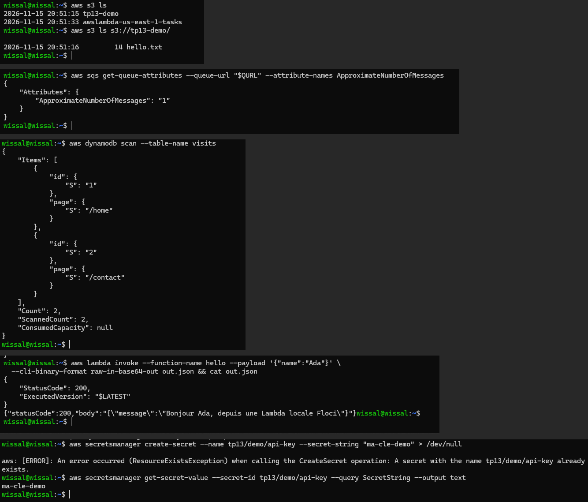

La capture regroupe S3 (`hello.txt`, 14 octets), SQS (`ApproximateNumberOfMessages = 1`), DynamoDB (`Count: 2`), `lambda invoke` (`StatusCode: 200`) et Secrets Manager. Sur la dernière commande, l'erreur `ResourceExistsException` indique simplement que le secret avait déjà été créé : `get-secret-value` relit bien `ma-cle-demo`.

> Avec `endpoint_url` dans le profil, l'option `--endpoint-url` est inutile. Il faut toujours vérifier le profil actif avant une commande destructive : sur un vrai compte AWS, la même commande aurait des effets réels.

---

## 4. Partie 2 : SDK JavaScript

```bash
cd sdk-demo && npm install && npm start
QUEUE_URL=$QURL npm start
```

Le programme écrit et liste des objets dans `tp13-demo`, puis envoie un message JSON dans la file SQS (TODO complété). Le message est relu avec `aws sqs receive-message`.


Le premier `npm start` liste `hello.txt` et affiche `QUEUE_URL manquant` (variable absente). Avec `QUEUE_URL=$QURL`, le programme envoie le message `{ event: 'contact.created', ... }` (MessageId affiché). `aws sqs receive-message` relit un message de la file : une file standard ne garantit pas l'ordre, donc c'est ici le premier message `{"event":"test"}` de la partie 1 qui est renvoyé.

**Question : quelle valeur prend `AWS_ENDPOINT_URL` dans le réseau Compose ?**
Dans Compose, `localhost` désigne le conteneur du programme lui-même, pas Floci. L'endpoint doit donc utiliser le nom du service Compose : `http://floci:4566` (si le service s'appelle `floci`).

---

## 5. Partie 3 : Terraform avec le provider AWS

### 5.1 Explication de `providers.tf`

| Élément | Rôle |
|---|---|
| `access_key` / `secret_key = "test"` | Identifiants fictifs, acceptés sans vérification par Floci. |
| `skip_credentials_validation` | Terraform ne vérifie pas les identifiants auprès du vrai STS d'AWS. |
| `skip_requesting_account_id` | Terraform ne demande pas l'ID de compte à AWS (appel externe inutile). |
| `skip_metadata_api_check` | Terraform ne contacte pas l'API de métadonnées EC2 (169.254.169.254), absente ici et source de timeout. |
| `s3_use_path_style = true` | URL de la forme `localhost:4566/<bucket>` au lieu de `<bucket>.localhost:4566`, dont le sous-domaine ne se résout pas en local. |
| `endpoints { ... }` | Redirige chaque service (S3, SQS, DynamoDB, Secrets Manager, Lambda, IAM, STS) vers Floci. Sans ce bloc, Terraform appellerait le vrai AWS. |
| `default_tags` | Ajoute automatiquement `project`, `environment` et `managed-by` à toutes les ressources. |

`required_version = ">= 1.10"` est exigé car le verrou natif `use_lockfile` n'existe que depuis Terraform 1.10.

### 5.2 Ressources créées (`main.tf`)

- **S3** : bucket versionné, accès public bloqué (4 options à `true`), chiffrement AES256.
- **SQS** : file `tp13-contact-<env>` avec file de lettres mortes (`maxReceiveCount = 3`) et `sqs_managed_sse_enabled = true`.
- **DynamoDB** : table `tp13-visits-<env>` (`PAY_PER_REQUEST`, clé `id` de type S).
- **Secrets Manager** : secret `tp13/<env>/api-key`, valeur fournie par la variable `api_key` marquée `sensitive = true` et passée par `TF_VAR_api_key` (jamais écrite dans le code).

### 5.3 Cycle complet

```bash
terraform init && terraform fmt && terraform validate
terraform plan -out tfplan
terraform apply tfplan
terraform output
```

Résultat : `Apply complete! Resources: 9 added, 0 changed, 0 destroyed.`
Dans le plan, la valeur du secret apparaît comme `(sensitive value)`.

Vérifications avec AWS CLI :

```bash
aws s3api get-bucket-versioning --bucket tp13-uploads-dev        # Enabled
aws s3api get-public-access-block --bucket tp13-uploads-dev      # 4 x true
aws s3api get-bucket-encryption --bucket tp13-uploads-dev        # AES256
aws sqs list-queues && aws dynamodb list-tables
aws secretsmanager get-secret-value --secret-id tp13/dev/api-key
```


### 5.4 Dérive (drift)

La table `tp13-visits-dev` est supprimée à la main avec AWS CLI, puis `terraform plan` est relancé.

**Réaction de Terraform :** il rafraîchit son state (*refresh*), constate que la table présente dans le state n'existe plus dans la réalité, et planifie sa **recréation** (`Plan: 1 to add, 0 to change, 0 to destroy`). Il ne modifie rien sans confirmation. Après `terraform apply`, la table est recréée (vide : Terraform restaure la structure, pas les données), puis `plan` affiche `No changes`.

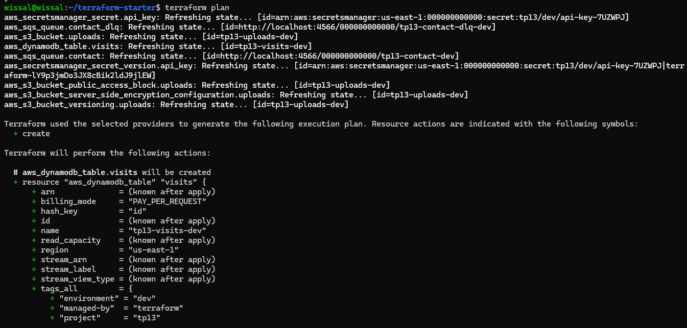


Réparation de la dérive (`terraform apply`, réponse `yes`), puis retour à un état propre :


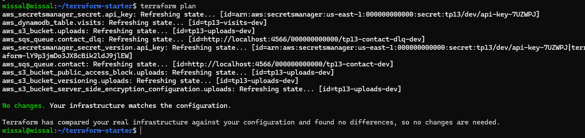

---

## 6. Partie 4 : modules, environnements et state distant

### 6.1 Notions

| Notion | Explication |
|---|---|
| State | Fichier JSON qui associe chaque ressource du code à un objet réel. Sans lui, Terraform ne sait plus ce qu'il gère. |
| Backend distant | Stocke le state hors du poste (ici S3) pour le partager en équipe et le sauvegarder. |
| Verrou | Empêche deux `apply` simultanés de corrompre le state. |
| Données sensibles | Le state contient des valeurs en clair (secrets) : il faut le chiffrer et restreindre son accès. |

### 6.2 Module `modules/secure-bucket`

Le bucket sécurisé (bucket, versioning, blocage d'accès public, chiffrement) est factorisé dans un module (`var.name`, `var.tags`, sorties `bucket` et `arn`), puis appelé deux fois :

```hcl
module "uploads" {
  source = "./modules/secure-bucket"
  name   = "tp13-uploads-${var.environment}"
}

module "backups" {
  source = "./modules/secure-bucket"
  name   = "tp13-backups-${var.environment}"
}
```

Quatre blocs `moved` déplacent dans le state les ressources existantes (`aws_s3_bucket.uploads` vers `module.uploads.aws_s3_bucket.this`, etc.). Le plan a affiché 4 lignes `has moved to ...` et `Plan: 4 to add, 0 to change, 0 to destroy` (les 4 ressources du nouveau bucket `backups`) : **aucune ressource existante n'a été détruite**.

### 6.3 Validation et fichiers `tfvars`

```hcl
variable "environment" {
  type    = string
  default = "dev"
  validation {
    condition     = contains(["dev", "staging", "prod"], var.environment)
    error_message = "environment doit valoir dev, staging ou prod."
  }
}
```

Fichiers `dev.tfvars`, `staging.tfvars` et `prod.tfvars` (sans secret). Le test `terraform plan -var="environment=test"` est refusé avec le message d'erreur de validation.


### 6.4 Backend S3 verrouillé

Bootstrap du bucket de state avec AWS CLI (il ne peut pas être créé par le projet qui l'utilise) :

```bash
aws s3 mb s3://tp13-tfstate
aws s3api put-bucket-versioning --bucket tp13-tfstate \
  --versioning-configuration Status=Enabled
```

`backend.tf` : bucket `tp13-tfstate`, clé `envs/dev/terraform.tfstate`, endpoint Floci, `use_path_style`, options `skip_*` et `use_lockfile = true`. Un backend ne peut pas utiliser de variables, donc tout y est écrit en dur.

Migration :

```bash
terraform init -migrate-state
aws s3 ls s3://tp13-tfstate/envs/
```

Résultat : `envs/dev/terraform.tfstate` et `envs/prod/terraform.tfstate` sont présents dans S3, et `terraform plan` affiche `No changes`.

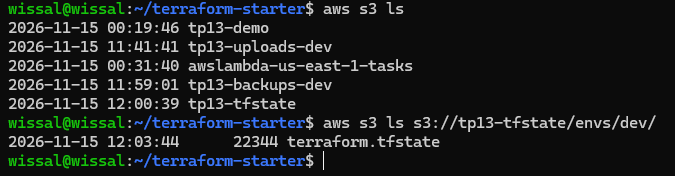

### 6.5 Test du verrou

Terminal 1 : `terraform apply -replace=aws_dynamodb_table.visits` laissé en attente à `Enter a value:`.
Terminal 2 : `terraform plan` échoue.

Terminal 1 : l'`apply` est laissé en attente de confirmation, ce qui garde le verrou.

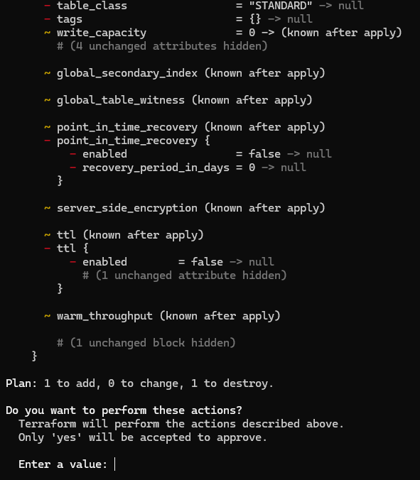

Terminal 2 : le `plan` est bloqué par le verrou.


L'erreur affiche `Error acquiring the state lock`, avec `PutObject ... StatusCode: 412 ... PreconditionFailed` et les informations du verrou (ID, chemin, opération `OperationTypeApply`, utilisateur). Cela prouve que **Floci gère les écritures conditionnelles S3** : le verrou natif `use_lockfile` fonctionne, donc **aucune bascule vers `dynamodb_table` n'a été nécessaire**.

### 6.6 Séparation des environnements

Une clé de state distincte par environnement, choisie à l'initialisation :

```bash
terraform init -backend-config="key=envs/prod/terraform.tfstate" -reconfigure
terraform plan -var-file=prod.tfvars     # Plan: 13 to add (state vide)
terraform apply -var-file=prod.tfvars
terraform init -backend-config="key=envs/dev/terraform.tfstate" -reconfigure
terraform plan -var-file=dev.tfvars      # No changes
```

**Comparaison des deux approches :**

| | Clé de state par environnement | Workspaces |
|---|---|---|
| Principe | Un fichier de state distinct, choisi à l'`init` | Plusieurs states dans le même backend, `terraform workspace select` |
| Visibilité | Explicite : le chemin indique l'environnement | Implicite : facile d'oublier dans quel workspace on se trouve |
| Risque | Oublier `-reconfigure` | Appliquer `prod` en étant resté sur `dev` |
| Isolation | Forte (backends ou droits différents possibles) | Faible (même backend, mêmes droits) |

Pour la production, la clé par environnement (ou des dossiers séparés) est préférable.

---

## 7. Partie 5 : scan IaC et OpenTofu

### 7.1 Checkov et Trivy

```bash
docker run --rm -v "$PWD:/tf" bridgecrew/checkov -d /tf --quiet
docker run --rm -v "$PWD:/tf" aquasec/trivy:latest config /tf
```

**Mauvaise configuration introduite** (sur une copie `terraform-bad`) : `block_public_acls = false`, `block_public_policy = false` et suppression du bloc de chiffrement S3.

Résultats :
- **Checkov** : `Passed checks: 20, Failed checks: 22`. Les échecs liés aux modifications : `CKV_AWS_53` (block public ACLs), `CKV_AWS_54` (block public policy) et `CKV2_AWS_6` (public access block).
- **Trivy** : `AWS-0087 (HIGH): Public access block does not block public policies` sur `modules/secure-bucket/main.tf`, ligne `block_public_policy = false`.


Code retour du scan bloquant sur le code cassé :

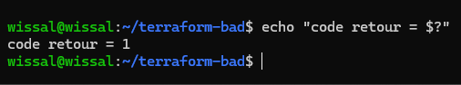

Sur le code sain, Checkov restreint aux contrôles d'accès public passe (`Failed checks: 0`, code retour 0) :


Alerte `AWS-0132` (KMS) de Trivy sur le code sain, acceptée dans `.trivyignore` :


**Code retour bloquant** (`--exit-code 1 --severity HIGH,CRITICAL`) :

| Code | Code retour |
|---|---|
| Sain (`terraform-starter`) | **0** |
| Cassé (`terraform-bad`) | **1** |

**Exceptions documentées dans `.trivyignore`** (risques acceptés en TP, émulateur local) :

| Identifiant | Raison |
|---|---|
| `AWS-0132` | Chiffrement SSE-S3 (AES256) au lieu d'une clé KMS gérée par le client. |
| `AWS-0096` | Chiffrement SQS géré par le service (`sqs_managed_sse_enabled`) ; cette version de Trivy ne reconnaît que `kms_master_key_id`. |

Les autres échecs Checkov (journalisation S3, réplication inter-régions, rotation des secrets, KMS pour DynamoDB, etc.) existaient déjà sur le code sain : ce sont des exigences de production, acceptées dans le cadre du TP.

**Intégration au pipeline** (Jenkinsfile du TP9) :


Équivalent GitHub Actions (TP10) :

```yaml
iac-scan:
  runs-on: ubuntu-latest
  steps:
    - uses: actions/checkout@v4
    - run: |
        docker run --rm -v "$PWD:/tf" aquasec/trivy:latest config /tf \
          --skip-version-check --ignorefile /tf/.trivyignore \
          --exit-code 1 --severity HIGH,CRITICAL
```

### 7.2 OpenTofu

Le cycle est rejoué sur une copie du projet, avec un state local et l'environnement `staging` (pour ne pas toucher aux states dev et prod) :

```bash
tofu init && tofu plan -var-file=staging.tfvars && tofu apply -var-file=staging.tfvars
```

Résultat : `Apply complete! Resources: 13 added, 0 changed, 0 destroyed.` avec **OpenTofu v1.13.9** et le provider `hashicorp/aws v6.73.0`. Le même code HCL fonctionne sans aucune modification.


**Comparaison Terraform / OpenTofu :**

| | Terraform | OpenTofu |
|---|---|---|
| Licence | BUSL 1.1 (source disponible, usage concurrent restreint) | MPL 2.0 (open source) |
| Gouvernance | HashiCorp | Linux Foundation, communauté |
| Providers | Registre HashiCorp | Registre OpenTofu, mêmes providers (ici `hashicorp/aws` sans changement) |
| State | JSON | Format compatible |
| Fonction propre | Terraform Cloud / HCP | Chiffrement du state côté client (bloc `encryption`) |

---

## 8. Comparaisons

### Floci, LocalStack et AWS réel

J'ai utilisé Floci pour tout le TP. Voici ce que j'ai constaté, comparé à LocalStack et à AWS réel.

| | Floci | LocalStack Community | AWS réel |
|---|---|---|---|
| Licence | MIT, libre | Jeton d'authentification exigé depuis mars 2026 (d'après l'énoncé, non testé) | Service commercial |
| Services couverts | Ceux du TP : S3, SQS, DynamoDB, Lambda, Secrets Manager, IAM, STS | Catalogue plus large, certains services payants (d'après l'énoncé) | Tous les services |
| Fidélité | Suffisante pour le TP : versioning, chiffrement S3 et verrou S3 conditionnel ont fonctionné. Les files SQS sont lentes (25 à 42 s) | Non testé | Comportement de référence |
| Coût | Gratuit, sans compte ni carte bancaire | Gratuit avec compte et jeton | Facturé à l'usage |
| Usage en CI | Pratique : un seul conteneur et aucun secret à gérer | Possible, mais le jeton doit être stocké comme secret | Coûteux et risqué : comptes dédiés et nettoyage nécessaires |

**Ce que j'en retiens.** Floci m'a permis de tester toute la chaîne (AWS CLI, SDK, Terraform, backend S3 verrouillé, OpenTofu) sans aucun risque de facture. Son principal défaut est la lenteur des files SQS. Je ne l'utiliserais pas pour valider le comportement exact d'un service, car l'émulation ne reproduit pas tout : par exemple, le scanner Trivy exige une clé KMS pour les files SQS, alors que l'émulateur ne gère que le chiffrement par le service. Pour une validation finale avant la production, un vrai compte AWS de test reste nécessaire.
## 9. Difficultés rencontrées

- **Variables d'environnement par terminal** : `AWS_PROFILE` et `TF_VAR_api_key` ne sont pas conservées d'un terminal à l'autre. Dans un nouveau terminal sans `TF_VAR_api_key`, le plan proposait de vider la valeur du secret (`secret_string = (sensitive value) -> null`). L'apply a été refusé. Chaque terminal doit redéfinir ces variables.
- **Pager AWS CLI** : l'option `export AWS_PAGER=""` évite les affichages `...skipping...`.
- **Scan Trivy sain à 1** : le code sain renvoyait 1 à cause de `AWS-0132` (KMS) puis `AWS-0096` (SQS). Ces alertes sont des limites de l'émulateur et de la règle, documentées dans `.trivyignore`.
- **Création lente des files SQS** : environ 25 s à la création et 42 s à la suppression, sans erreur.
- **Plan vide après `sqs_managed_sse_enabled`** : le provider v6 active déjà ce chiffrement par défaut, l'attribut explicite sert surtout à rendre l'intention lisible pour les scanners.

---

## 10. Nettoyage

```bash
tofu destroy -var-file=staging.tfvars                      # state local
terraform init -backend-config="key=envs/prod/terraform.tfstate" -reconfigure
terraform destroy -var-file=prod.tfvars
terraform init -backend-config="key=envs/dev/terraform.tfstate" -reconfigure
terraform destroy -var-file=dev.tfvars
docker rm -f floci
```

Résultat pour dev : `Destroy complete! Resources: 13 destroyed.` Le conteneur `floci` est supprimé en dernier (il efface aussi le bucket `tp13-tfstate`).

---

## 11. Liste des captures

| Fichier | Contenu | Aperçu |
|---|---|---|
| `floci-cli.png` | Commandes S3, SQS, DynamoDB et `lambda invoke` réussies |  |
| `sdk-demo.png` | Programme SDK : objets listés et message SQS envoyé |  |
| `terraform-apply.png` | `terraform apply` puis vérification avec AWS CLI |  |
| `drift.png` | `terraform plan` après suppression manuelle de la table |  |
| `remote-state.png` | State présent dans `s3://tp13-tfstate/envs/` |  |
| `state-lock.png` | Erreur `Error acquiring the state lock` |  |
| `iac-scan.png` | Trivy détectant `AWS-0087` sur le code cassé, code retour 1 |  |
| `opentofu.png` | `tofu apply` réussi (13 ressources) |  |

### Captures complémentaires

| Fichier | Contenu |
|---|---|
| `drift-2.png`, `drift-reparation.png`, `drift-no-changes.png` | Fin du plan de dérive, réparation, retour à `No changes` |
| `validation-environment.png` | Refus de `environment=test` par la validation |
| `state-lock-terminal1.png` | Terminal 1 : `apply` en attente de confirmation |
| `iac-scan-code-retour-casse.png`, `iac-checkov-sain.png`, `iac-trivy-sain-aws0132.png` | Détails du scan IaC |
| `opentofu-version.png` | `tofu version` : OpenTofu v1.13.9 |

---

# TP14 : Kubernetes avec K3s

**Auteur :** Wissal
**Dates :** 15 au 17 novembre 2026
**Environnement :** Ubuntu Server 26.04, K3s v1.36.5+k3s1 (containerd 2.3.4), kubectl v1.37.2, Ansible core 2.20.1, Vagrant 2.4.9, noyau 7.0.0-43-generic

---

## Sommaire

1. [Choix de l'environnement (plan B)](#1-choix-de-lenvironnement-plan-b)
2. [Structure du rendu](#2-structure-du-rendu)
3. [Partie 1 : cluster K3s avec Ansible](#3-partie-1--cluster-k3s-avec-ansible)
4. [Partie 2 : Pods et Deployments](#4-partie-2--pods-et-deployments)
5. [Partie 3 : Services et Ingress](#5-partie-3--services-et-ingress)
6. [Partie 4 : ConfigMap et Secret](#6-partie-4--configmap-et-secret)
7. [Partie 5 : santé, ressources, déploiements progressifs](#7-partie-5--santé-ressources-et-déploiements-progressifs)
8. [Partie 6 : stockage persistant](#8-partie-6--stockage-persistant)
9. [Partie 7 : HorizontalPodAutoscaler](#9-partie-7--horizontalpodautoscaler)
10. [Défi](#10-défi)
11. [Difficultés rencontrées](#11-difficultés-rencontrées)
12. [Liste des captures](#12-liste-des-captures)

---

## 1. Choix de l'environnement (plan B)

Le sujet prévoit un cluster à deux nœuds créé par Vagrant. Ce n'était pas possible sur ma VM de lab :

| | Ma VM | Requis |
|---|---|---|
| vCPU | 4 | 4 |
| RAM | 4,2 Gio | 8 Go |
| VirtualBox | non installé | indispensable pour `vagrant up` |

Les deux VM du `Vagrantfile` demandent 5 Go de RAM à elles seules. J'ai donc appliqué le **plan B** du sujet : K3s directement sur la VM de lab, en **nœud unique**.

Un cluster K3s (v1.36.5+k3s1) existait déjà sur cette VM depuis 32 jours et héberge une autre application (`spring-app-deployment`, namespace `default`). Je ne l'ai pas désinstallé : le TP travaille dans son propre namespace `tp14`, sans conflit, et le playbook Ansible a été exécuté sur le cluster existant (il est idempotent). Les conséquences pour le rendu :

- `cluster-nodes.png` montre un seul nœud ;
- `rebuild.png` illustre l'**idempotence** du playbook (deuxième exécution, `changed=0`) à la place de `vagrant destroy -f && vagrant up` ;
- la question « sur quels nœuds sont répartis les Pods ? » a pour réponse « un seul » ;
- le Défi (troisième nœud, `drain`) n'est pas réalisable sur un nœud unique.

Le nom `whoami.lab.local` pointe vers l'adresse de Traefik sur la VM (`172.28.79.32`) dans `/etc/hosts`, au lieu de `192.168.56.10` qui n'existe pas en nœud unique.

---

## 2. Structure du rendu

Les fichiers du TP14 sont dans le dossier `tp14/` du dépôt, et ses captures dans `captures/tp14/` :

```
tp14/
├── k3s-lab/
│   ├── Vagrantfile
│   ├── playbook.yml
│   ├── inventory-local.ini
│   └── roles/k3s/
│       ├── defaults/main.yml
│       └── tasks/{server,agent}.yml
└── k8s-starter/
    ├── 01-namespace.yaml
    ├── 02-config.yaml
    ├── 03-deployment.yaml
    ├── 04-service.yaml
    ├── 05-ingress.yaml
    ├── 05b-api.yaml
    ├── 06-postgres.yaml
    └── 07-hpa.yaml
captures/tp14/            (captures d'écran du TP14)
```

Aucun fichier `k3s.yaml` (kubeconfig) et aucun Secret ne sont dans le dépôt : les Secrets sont créés en ligne de commande.

---

## 3. Partie 1 : cluster K3s avec Ansible

### 3.1 Architecture d'un cluster

| Composant | Rôle |
|---|---|
| API server | Point d'entrée unique : `kubectl` et tous les composants lui parlent. |
| Datastore | État du cluster (SQLite par défaut avec K3s, etcd en haute disponibilité). |
| Scheduler | Choisit le nœud de chaque Pod selon les ressources demandées. |
| Controllers | Boucles qui rapprochent l'état réel de l'état désiré (ReplicaSet, Deployment...). |
| kubelet | Agent de chaque nœud : démarre les conteneurs via containerd. |

### 3.2 Playbook

Le `playbook.yml` complété installe K3s en mode server de façon idempotente (`creates: /usr/local/bin/k3s`, avec `--node-ip`, `--tls-san` et `--write-kubeconfig-mode 644`), lit le jeton du server (`slurp`) et le stocke dans un fait (`set_fact`), rapatrie `k3s.yaml` (`fetch`) puis remplace `127.0.0.1` par l'adresse du server. Le play des agents (`K3S_URL`, `K3S_TOKEN`) est écrit mais ignoré en nœud unique (`skipping: no hosts matched`).

Comme `sudo` sur Ubuntu 26.04 gère mal l'invite de mot de passe d'Ansible (`Timed out waiting for become success`), j'ai lancé le playbook en root :

```bash
cd ~/k3s-lab
time sudo ansible-playbook -i inventory-local.ini -e k3s_server_ip=127.0.0.1 playbook.yml
```

Première exécution : `ok=8 changed=1 failed=0` (seul changement : le rapatriement de `k3s.yaml`), en 38 s.

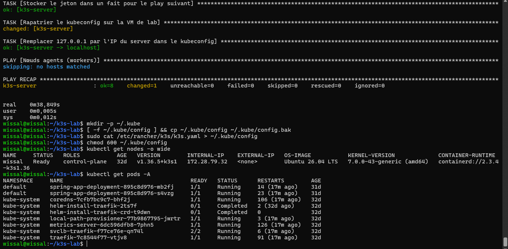

Le nœud `wissal` est `Ready` (control-plane), et `coredns`, `traefik`, `local-path-provisioner` et `metrics-server` tournent.

### 3.3 Rôle `k3s`

Le playbook a été transformé en rôle : `roles/k3s/tasks/server.yml`, `tasks/agent.yml` et `defaults/main.yml`, qui épingle la version avec `k3s_version: "v1.36.5+k3s1"` (variable `INSTALL_K3S_VERSION`). Le playbook appelle les deux fichiers par `include_role` avec `tasks_from`.

Une remarque honnête : comme K3s était déjà installé, l'étape d'installation est ignorée, donc la version épinglée n'a pas été réellement exercée sur ce cluster.

### 3.4 Reconstruction et idempotence

Je n'ai pas détruit le cluster, car il héberge une autre application. J'ai donc démontré l'idempotence : après le passage au rôle, une nouvelle exécution du playbook donne `ok=9 changed=0 failed=0` (11 à 21 secondes), sans réinstaller K3s.


---

## 4. Partie 2 : Pods et Deployments

```bash
kubectl run test --image=traefik/whoami:v1.10.0
kubectl delete pod test
kubectl apply -f k8s-starter/01-namespace.yaml -f k8s-starter/03-deployment.yaml
```

**Le Pod lancé à la main est-il recréé ?** Non. Un Pod créé avec `kubectl run` n'a aucun contrôleur au-dessus de lui : une fois supprimé, personne ne le remet en place.

**Un Pod du Deployment est supprimé :** un nouveau Pod apparaît en 1 seconde, car le ReplicaSet maintient 2 réplicas. Le second Pod n'a pas bougé.

**Sur quels nœuds sont répartis les Pods ?** Sur un seul nœud (`wissal`), puisque le cluster n'en a qu'un.

**`kubectl exec -it ... -- sh`** échoue avec `exec: "sh": executable file not found in $PATH` : l'image `whoami` est minimale et ne contient pas de shell.

**`kubectl explain deployment.spec.strategy.rollingUpdate` :** `maxSurge` et `maxUnavailable` valent 25 % par défaut (arrondis respectivement à 1 par excès et 0 par défaut avec 2 réplicas).

`kubectl describe` montre dans `Events` : `Scheduled`, `Pulled`, `Created`, `Started`. Au départ, la classe de QoS est `BestEffort` (ni `requests` ni `limits`).

---

## 5. Partie 3 : Services et Ingress

Le Service `whoami` (`ClusterIP`, port 80 vers le port nommé `http`) reçoit le `selector` `app: whoami`. L'Ingress `traefik` route `whoami.lab.local/` vers ce Service.

Un second Service sert la route `/api` : `05b-api.yaml` contient une ConfigMap (`api-page`, qui apporte une page HTML), un Deployment `nginx:1.27-alpine` et le Service `api`. La règle `/api` est ajoutée à l'Ingress existant, dans le même fichier.

```bash
curl -s http://whoami.lab.local | head -4
curl -sL http://whoami.lab.local/api/
kubectl -n tp14 get svc,ingress
```

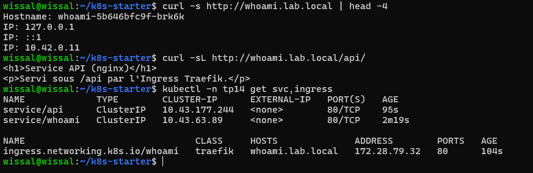

La capture montre la réponse de `whoami` (Hostname et IP du Pod), la page de `/api/` servie par nginx, les deux Services `ClusterIP` et l'Ingress `traefik` pour `whoami.lab.local`.

| Type de Service | Accès |
|---|---|
| ClusterIP | Interne au cluster uniquement (par défaut). |
| NodePort | Port 30000 à 32767 ouvert sur chaque nœud. |
| LoadBalancer | IP externe (fournie par ServiceLB sur K3s, par le cloud ailleurs). |
| Ingress | Routage HTTP par nom d'hôte et chemin vers des Services ClusterIP. |

---

## 6. Partie 4 : ConfigMap et Secret

Le Secret est créé en ligne de commande (il n'est pas versionné) :

```bash
kubectl -n tp14 create secret generic whoami-secret --from-literal=api-key='lab-only-value'
kubectl -n tp14 get secret whoami-secret -o yaml
kubectl -n tp14 get secret whoami-secret -o jsonpath='{.data.api-key}' | base64 -d
```

La valeur apparaît en base64 (`bGFiLW9ubHktdmFsdWU=`) et `base64 -d` redonne immédiatement `lab-only-value`. **Base64 n'est pas du chiffrement** : la protection d'un Secret vient du contrôle d'accès (RBAC) et du chiffrement au repos du datastore.

La ConfigMap `whoami-config` (clés `WHOAMI_NAME` et `LOG_LEVEL`, TODO complété) est injectée avec `envFrom`, et la clé `api-key` du Secret par `secretKeyRef` (variable `API_KEY`). La page `whoami` avec `?env=true` affiche `API_KEY=lab-only-value`.

**La valeur change-t-elle dans les Pods existants après modification de la ConfigMap ?** Non. Test en une seule séquence (`WHOAMI_NAME` passe de `tp14-v2` à `tp14-v3`, et `LOG_LEVEL` de `info` à `debug`) :

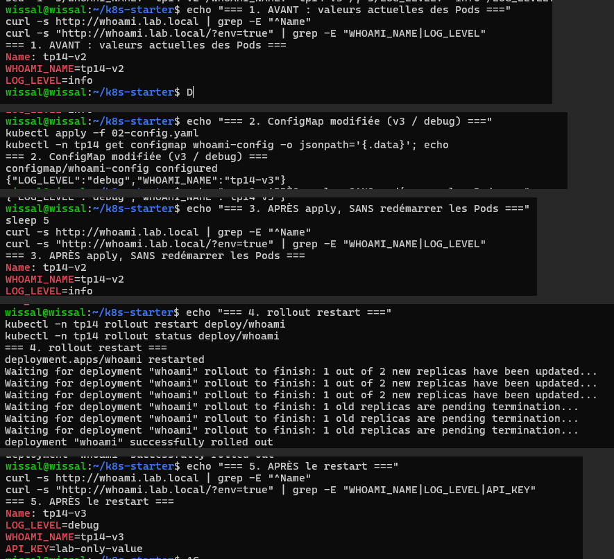

| Étape | `Name` | `LOG_LEVEL` |
|---|---|---|
| 1. avant | `tp14-v2` | `info` |
| 3. après `apply`, sans redémarrer | `tp14-v2` (inchangé) | `info` (inchangé) |
| 5. après `kubectl rollout restart` | `tp14-v3` | `debug` |

Les variables d'environnement sont lues au démarrage du conteneur : il faut `kubectl rollout restart deploy/whoami` pour les renouveler.

---

## 7. Partie 5 : santé, ressources et déploiements progressifs

### 7.1 Probes et ressources

Le Deployment reçoit une `readinessProbe` (HTTP `/health`, toutes les 3 s, 2 échecs) et une `livenessProbe` (HTTP `/health`, toutes les 5 s, 3 échecs), ainsi que `requests` (50m CPU, 32Mi) et `limits` (200m CPU, 64Mi). La classe de QoS passe à `Burstable`.


### 7.2 Panne simulée

`whoami` permet de forcer le code de `/health` :

```bash
kubectl -n tp14 port-forward deploy/whoami 8081:8080 &
curl -X POST -d '500' localhost:8081/health
kubectl -n tp14 get pods -w
```

Séquence observée : le Pod passe à `0/1` (la `readinessProbe` échoue : il sort des endpoints du Service mais n'est pas tué), puis `RESTARTS` passe à `1` (la `livenessProbe` a échoué 3 fois, kubelet redémarre le conteneur), puis le Pod revient à `1/1`. Le second Pod a continué à servir.


Les `Events` indiquent `Readiness probe failed` (x6) et `Liveness probe failed` (x3) avec `statuscode: 500`, puis `Container whoami failed liveness probe, will be restarted`.

### 7.3 Rolling update et rollback

```bash
kubectl -n tp14 set image deploy/whoami whoami=traefik/whoami:v1.10.1
kubectl -n tp14 set image deploy/whoami whoami=traefik/whoami:v9.9.9   # image inexistante
kubectl -n tp14 get pods
kubectl -n tp14 rollout history deploy/whoami
kubectl -n tp14 rollout undo deploy/whoami
```

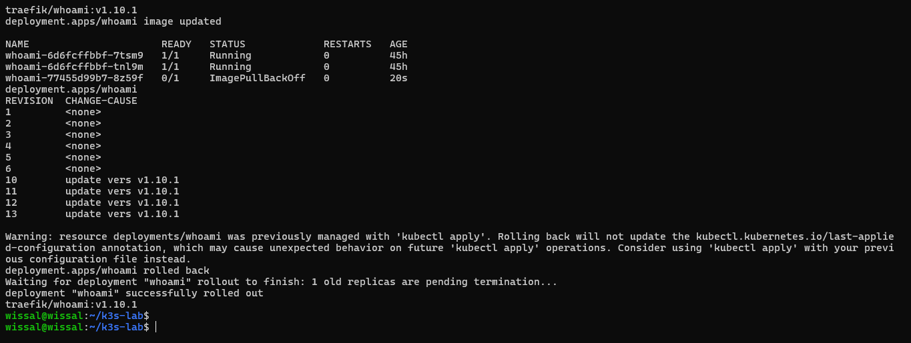

Le nouveau Pod est en `ImagePullBackOff` pendant que les deux anciens restent `Running`. `rollout undo` ramène l'image à `traefik/whoami:v1.10.1`. Une boucle de `curl` lancée pendant l'opération a reçu **35 réponses `200` sur 35** : aucune interruption.

Une remarque sur l'historique : l'annotation `change-cause` `update vers v1.10.1` apparaît sur plusieurs révisions. Elle est copiée d'une révision à l'autre tant qu'on ne la met pas à jour.

**Pourquoi le service n'a jamais été interrompu ?**

- `maxSurge` (25 %, arrondi à 1 avec 2 réplicas) : Kubernetes crée **d'abord** un nouveau Pod avant d'en retirer un ancien.
- `maxUnavailable` (25 %, arrondi à 0) : aucun ancien Pod ne peut être retiré tant qu'un nouveau n'est pas prêt.
- La `readinessProbe` : un Pod n'entre dans les endpoints du Service que s'il est `Ready`. Le Pod en `ImagePullBackOff` ne l'est jamais, donc il ne reçoit aucun trafic et les anciens Pods ne sont pas supprimés. Le déploiement reste bloqué, mais le service continue de fonctionner.

Le manifest `03-deployment.yaml` a été aligné sur l'image `v1.10.1` pour qu'un futur `kubectl apply` ne fasse pas redescendre la version.

### 7.4 OOMKilled

Avec `whoami`, les limites de **4 Mi** et **8 Mi** n'ont pas déclenché de `OOMKilled` : le Pod a démarré et est passé `Ready`, car ce binaire consomme très peu de mémoire. Le comportement a été démontré avec un Pod qui consomme volontairement de la mémoire (limite 16 Mi), qui a été tué :


`Reason: OOMKilled` et `Exit Code: 137` (128 + signal 9). Les valeurs d'origine ont été restaurées sur le Deployment (`limits` 200m / 64Mi, `requests` 50m / 32Mi).

---

## 8. Partie 6 : stockage persistant

### 8.1 Déploiement

Le Secret `postgres-secret` est créé en ligne de commande. Le montage du PVC `pgdata` (1 Gi, StorageClass `local-path`) est ajouté au Deployment `postgres` (`volumes` et `volumeMounts` sur `/var/lib/postgresql/data`). La stratégie `Recreate` est conservée : un volume `ReadWriteOnce` ne peut être monté que par un Pod à la fois. Le premier démarrage a pris 22 minutes à cause du téléchargement de l'image (connexion lente).

### 8.2 Test de persistance

```bash
kubectl -n tp14 exec deploy/postgres -- psql -U postgres \
  -c "CREATE TABLE IF NOT EXISTS visits(id serial PRIMARY KEY, page text);" \
  -c "INSERT INTO visits(page) VALUES ('/home'),('/contact');" \
  -c "SELECT * FROM visits;"
kubectl -n tp14 delete pod -l app=postgres
kubectl -n tp14 exec deploy/postgres -- psql -U postgres -c "SELECT * FROM visits;"
```


Le Pod a changé de nom (`zr9b4` puis `nm7tq`), mais les deux lignes `/home` et `/contact` sont toujours présentes : la donnée est sur le volume, pas dans le conteneur.

### 8.3 Où sont stockées les données ? Quelle limite ?

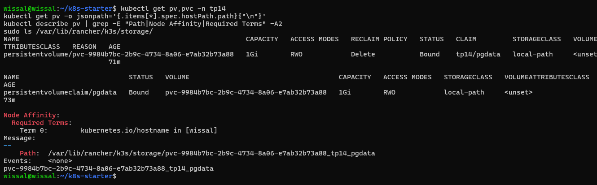

- **Où ?** Dans un dossier du disque du nœud : `/var/lib/rancher/k3s/storage/pvc-9984b7bc-..._tp14_pgdata`. Ce n'est pas un stockage réseau.
- **Quelle limite ?** Le PV porte une **affinité de nœud** (`kubernetes.io/hostname in [wissal]`) : si le Pod était replanifié sur un autre nœud, il resterait `Pending`, car le volume ne le suit pas. Il n'y a ni réplication ni sauvegarde. Sur un nœud unique le problème ne se voit pas, mais il existe. Pour du multi-nœuds, il faut un stockage réseau (Longhorn, NFS, Ceph ou un stockage cloud).
- **`reclaimPolicy: Delete`** : supprimer le PVC supprime aussi le volume et ses données.

---

## 9. Partie 7 : HorizontalPodAutoscaler

`metrics-server` fonctionne (`kubectl top nodes` : 5 % de CPU, 59 % de mémoire). Le HPA `whoami` cible le Deployment `whoami` : minimum 2, maximum 6 réplicas, seuil de 50 % d'utilisation CPU (par rapport aux `requests`, ce qui exige que `requests.cpu` soit défini : 50m, donc environ 25m par Pod pour déclencher).


Charge générée depuis un Pod `busybox` qui lance 4 boucles `wget` en parallèle contre `http://whoami` :


Sous charge, `TARGETS` dépasse largement la cible (`160 %/50 %`) et `REPLICAS` monte au maximum (6). Chaque Pod `whoami` consomme environ 80 à 90m de CPU.

Après l'arrêt de la charge, l'utilisation retombe à 2 % et `REPLICAS` redescend de 6 à 3 puis à 2, environ cinq minutes plus tard : c'est la fenêtre de stabilisation par défaut du HPA (5 minutes), qui évite les oscillations.

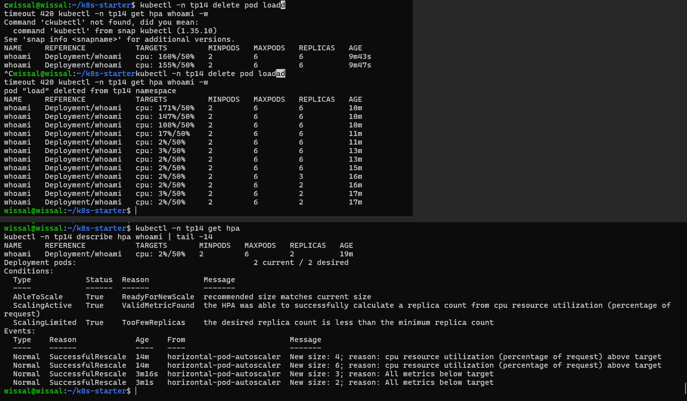

Les `Events` du HPA confirment : `New size: 4` puis `New size: 6` (`cpu resource utilization above target`), puis `New size: 3` et `New size: 2` (`All metrics below target`).

---

## 10. Défi

Non réalisé : le troisième nœud et `kubectl drain` supposent un cluster multi-nœuds. Sur mon nœud unique, un `drain` rendrait le nœud non planifiable et déplacerait aussi les autres applications du cluster. Le PodDisruptionBudget n'a pas été testé pour la même raison.

---

## 11. Difficultés rencontrées

- **Ressources insuffisantes pour Vagrant** (4 vCPU, 4,2 Gio de RAM, VirtualBox absent) : passage au plan B en nœud unique, sur un cluster K3s préexistant que j'ai conservé.
- **`sudo` et Ansible** : `Timed out waiting for become success or become password prompt`, probablement à cause du `sudo` de Ubuntu 26.04 ; contourné en lançant `ansible-playbook` en root.
- **Téléchargements lents** : une image de plusieurs dizaines de Mo prend plusieurs minutes (jusqu'à 22 minutes pour `postgres:17-alpine`). Un `rollout status` avec un délai de 180 secondes expirait donc alors que le déploiement continuait en arrière-plan.
- **PostgreSQL ne démarrait pas** : le conteneur restait `1/1 Running` sans que le serveur soit lancé (aucune ligne dans `logs`, processus `gosu` à 100 % de CPU). Après un passage en utilisateur non root (`runAsUser: 70`), l'erreur est devenue `could not signal for checkpoint: Permission denied`. Le journal du noyau (`dmesg`) contenait des refus `apparmor="DENIED" operation="signal"` pour le profil `cri-containerd.apparmor.d`. Ajouter `appArmorProfile: Unconfined` au `securityContext` du Pod a réglé le problème. C'est un contournement propre à cette VM, qui réduit l'isolation du conteneur ; ce n'est pas une bonne pratique générale. La cause du blocage initial dans `gosu` n'est pas établie avec certitude.
- **Limite mémoire de `whoami`** : 4 Mi et 8 Mi n'ont pas provoqué d'`OOMKilled`, d'où l'usage d'un Pod de démonstration.

---

## 12. Liste des captures

| Fichier | Contenu |
|---|---|
| `cluster-nodes.png` | Nœud `Ready`, pods système, `PLAY RECAP` de la première exécution |
| `rebuild.png` | Deuxième exécution du playbook : `changed=0` (idempotence) |
| `ingress.png` | `curl` sur `whoami.lab.local` et `/api`, Services et Ingress |
| `probes-restart.png` | Pod redémarré par la livenessProbe (`RESTARTS 1`, `Unhealthy`, `Killing`) |
| `rollout-undo.png` | `ImagePullBackOff`, `rollout history`, `rollout undo` |
| `pvc-persistence.png` | Donnée PostgreSQL conservée après suppression du Pod |
| `hpa.png` | HPA : descente de 6 à 2 réplicas et événements de mise à l'échelle |

Captures complémentaires :

| Fichier | Contenu |
|---|---|
| `configmap-restart.png` | ConfigMap : avant, après `apply`, après `rollout restart` |
| `probes-config.png` | Probes, `requests`/`limits` et QoS `Burstable` |
| `oomkilled.png` | Pod tué par manque de mémoire (`OOMKilled`, 137) |
| `pv-stockage.png` | PV, PVC, chemin sur le nœud et affinité de nœud |
| `metrics-hpa-manifest.png` | `kubectl top` et manifest du HPA |
| `hpa-charge-pods.png` | 6 Pods `whoami` et consommation CPU sous charge |
